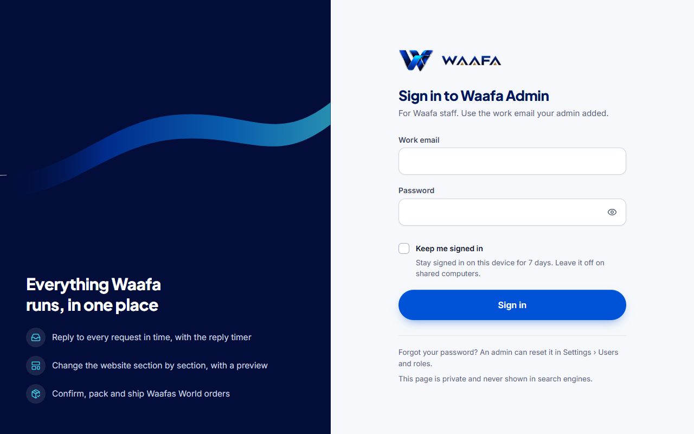
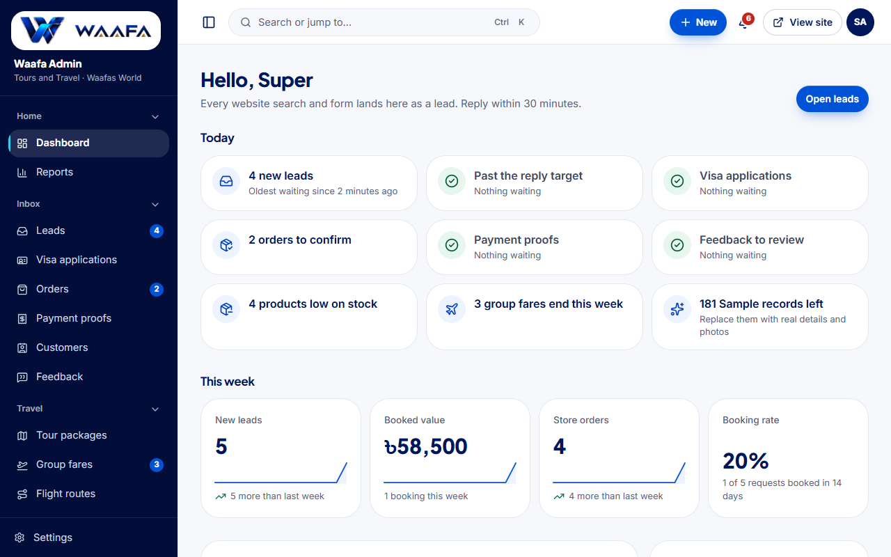
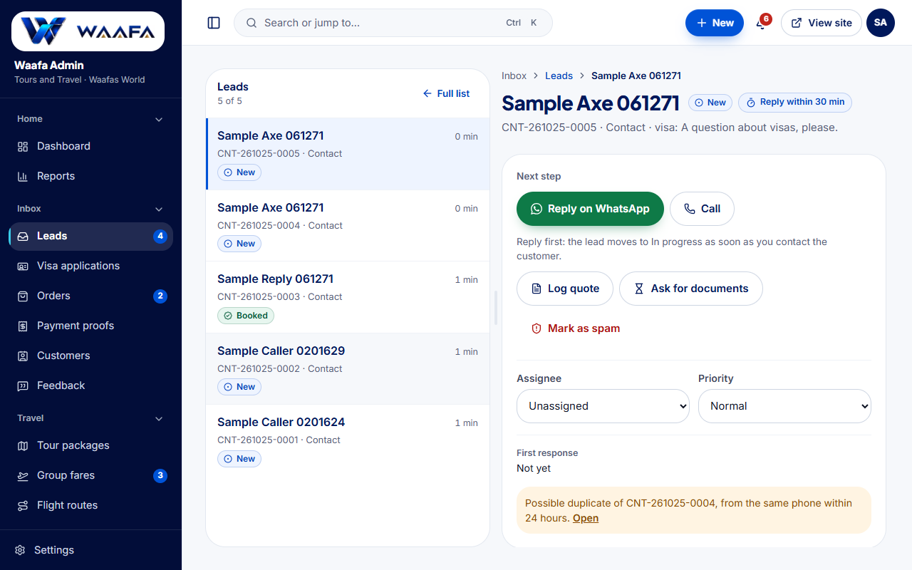
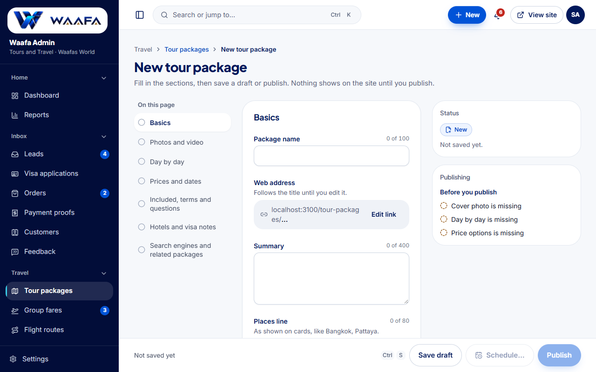
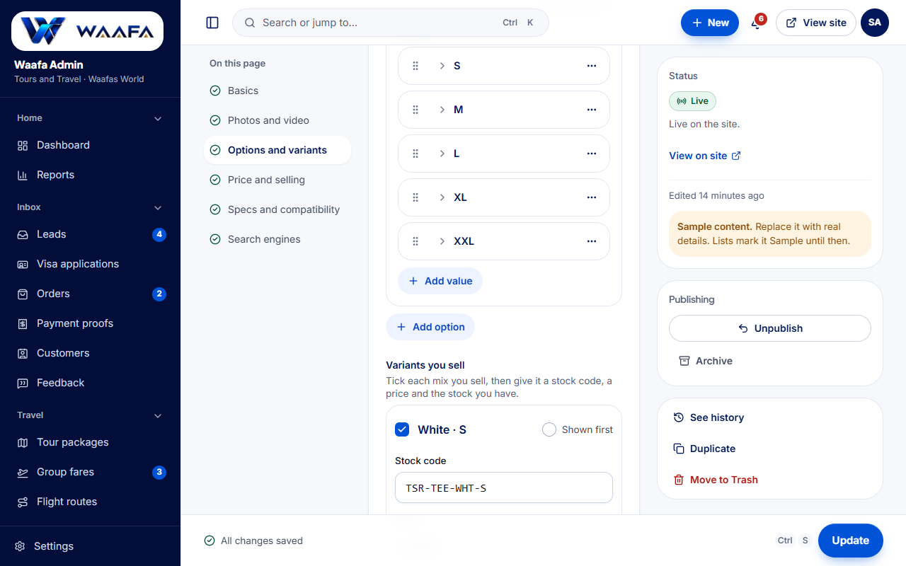
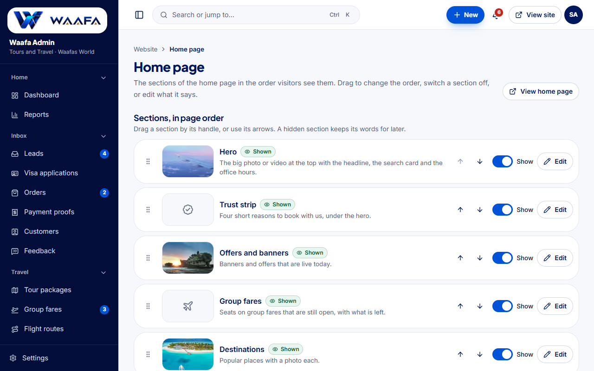
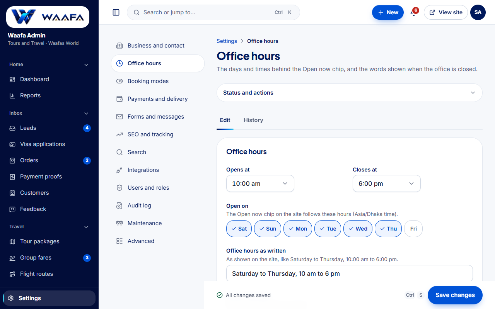

# Waafa Admin: staff guide

Ei guide Waafa-r staff-der jonno. Admin khule ki kaj kothay korben, choto kore bola ache. Kono ID, link, code ba
tarikh nijer haate likhte hoy na: system nije bosiye dey.

Admin-er thikana: `https://waafasworld.com/secure-admin-control` (bookmark kore rakhun).

---

## 1. Sign in

- Kaajer email ar password din. Nijer computer hole "Keep me signed in" tick din (7 din sign in thakben).
- Password bhul hole lal lekha dekhaben. 5 bar bhul hole 15 minute opekkha korte hobe.
- Notun staff hole email-e ekta **invite** asbe. Link-e click kore nijer password thik korun (link 7 din kaaj kore).
- Password bhule gele admin-ke bolun: Settings › Users and roles theke reset kore deben.
- **Two-step sign-in** (Super Admin ar Admin-er jonno lagbei, onnora My account theke chalu korte paren): phone-e
  Google Authenticator ba Microsoft Authenticator rakhun. Prothombar sign in korle QR code dekhabe: app diye scan korun,
  app-er 6-digit code din. Tarpor 10 ta **recovery code** dekhabe: copy ba download kore phone theke dure rakhun.
- Porer bar notun browser-e password-er por app-er code chaibe. Nijer computer hole "Trust this device for 30 days" tick
  din: 30 din oi browser-e code lagbe na.
- Phone haralen? Ekta recovery code din (protyekta ekbar-i kaaj kore). Recovery code-o nei? Super Admin Users and roles
  theke "Reset two-step sign-in" korben; porer sign-in-e abar setup hobe.
- Notun device theke sign in hole email ashbe. Chena na hole sathe sathe password bodlan. My account-e shesh 10 ta
  sign-in dekha jay.

## 2. Dashboard: ajker kaaj

- **Today** card gulo bole ki opekkhay ache: notun lead, reply-r somoy par hoye gese emon lead, confirm korar order,
  check korar payment proof, low stock, ei soptahe sesh hobe emon group fare, Sample content.
- Card-e click korlei oi list khule jay. "Nothing waiting" mane sob kaaj sesh.
- **This week**: notun lead, booked value, order ar booking rate, gato soptahe-r tulonay koto bere/kome gese.
- **Get the site ready**: setup-er baki kaaj. Kaaj sesh hole nijei tick pore jay.

## 3. Leads: customer-er request

- Sidebar › **Leads**. Upore tab: All, Flights, Hotels, Packages, Visa ityadi. List-e naam, service, kotokkhon
  opekkha korche (reply timer) dekhaben.
- Lead khule **WhatsApp** ba **Call** button chaplei lead nijei **In progress** hoye jay. Status haate bodlate hoy na.
- Quote pathale **Log quote**, document ba payment chaile **Ask for documents / Ask for payment**.
- Booking pakka hole **Convert to booking**: amount din, lead **Booked** hoye jay.
- Kaaj na hole **Close lead**: karon likhun (Lost ba Cancelled).
- Board view (Leads › Board): card tene arek column-e niye gele same prosno korbe (amount, karon).
- Phone-e o sob kaaj kora jay: niche button bar thake.

## 4. Visa applications

- Sidebar › **Visa applications**. Protiti application-er document checklist ache.
- Document pele tick din: ring bhore jay, sob dorkari document hole **Ready to submit**.
- Customer-er pathano file prothome virus check hoy (**Checking for viruses**, sadharonoto kichhu second). Tarpor
  **Open** dekhabe. Lal **Failed the malware scan** dekhale file khola jabe na: customer-ke abar pathate bolun.
- Jama dile tarikh ar reference din (**Submitted**), por e result (**Approved / Rejected**), passport ferot dile
  **Passport returned**.

## 5. Orders ar payment proof (Waafas World)

- **Payment proofs**: customer-er pathano proof order-er sathe nijei mile jay ("Matched"). **Verify** chaplei order
  paid ar confirmed hoye jay. Na mille **Reject** din ar karon likhun (customer email pan).
- **Orders**: Cash on delivery hole call kore **Confirmed on call**. Tarpor **Start packing**, courier ar tracking
  number diye **Ship**, pouchale **Mark delivered**. Cancel ba return karon soho; stock nijei thik hoy.

## 6. Customers

- Sidebar › **Customers**. Phone number (jemon 01712…) diye khunjun.
- Customer khulle tar sob request ar order ek jaygay.

## 7. Tour package jog kora

- **+ New › Tour package** (ba Tour packages › New). Bam pashe section gulo: Basics → Photos → Day by day → Prices
  and dates → Included → Hotels and visa notes → SEO. Protiti section-er sheshe **Next** button.
- Photo: tene ene chhere din ba **Upload photos**. Prothom photo-ta cover. Library theke o neya jay.
- Day by day: **Add day** diye din onujayi plan. Din-er number nijei bose.
- Prices: **Add price** diye protiti option (jemon "Twin sharing"). "Price from" nijei kom dam-ta theke hoy.
- Dan pashe **Before you publish** bole ki baki. Sob thik hole **Publish**. Pore chaile **Schedule…** diye
  tarikh thik korun.
- Bhul save hoye gele? **History** tab › **Restore this version**. Purono dam firot ase.

## 8. Product jog kora (Waafas World)

- **+ New › Product**. Options-e "Colour" ba "Pack" likhe value din (Black, Cyan…). Protiti mix ekta row hoye jay.
- Row-e **Sell** tick, stock code (nijei suggest kore), price, discount-er age-r dam ar stock din.
- Kon variant prothome dekhabe, radio button diye bachun.
- Stock komle list-e **Low stock**, shesh hole **Out of stock** nijei dekhay.

## 9. Photo ar video

- Je kono photo-r jaygay: tene ene chhere din, click kore upload, copy-paste, ba **Choose from library**.
- Photo khub choto hole holud satorkota dekhabe. **Crop** diye frame thik korun, focal point din (mukh jate na kate).
- **Photo description** lagbe (Google ar chokhe-dekhte-na-paowa manusher jonno). Title theke nijei suggest kore.
- Sidebar › **Media library**: sob photo-video, kothay byabohar hocche, **Replace everywhere**.

## 10. Website: home page, menu, banner

- Sidebar › **Home page**: section gulo page-er kram onujayi. Switch off korle site theke lukay. Upore-niche arrow ba
  tene kram bodlan.
- **Edit Hero**: headline ar lekha bodlan, preview dekhte paben. Photo ba video bodlate **Change photo or video**.
- **Menus**: header, footer ar phone menu. **Add an item**, link picker theke page ba record bachun.
- **Banners and offers**: banner khule dan pashe **Starts** tarikh din (jemon samner shukrobar): chip-e **Scheduled**
  dekhabe, oi din nijei live hobe. **Ends** dile sesh-e nijei nemay.
- **Preview on site**: publish-er age site-e kemon dekhabe, sudhu staff dekhte pan.
- Site-e sign in obosthay niche **Edit this page** button: oi page-er editor khule dey.

## 11. Settings

- Sidebar-er niche **Settings**. Bam pashe section: Business and contact, Office hours, Booking modes, Payments and
  delivery, Forms and messages, SEO and tracking, Users and roles, Audit log…
- **Office hours**: kon din, koyta theke koyta. Site-er "Open now" chip eta dekhe chole.
- **Business and contact**: phone number, WhatsApp, email, thikana, social link.
- **Forms and messages › Email and SMS**: customer ki email pan. Lekhay customer-er naam ba reference dite
  **Insert** button chapun; niche preview-te asol email-er moto dekhabe.
- Protiti section-er niche nijer **Save changes** button.

### 11.1 Integrations: bairer sob service ek jaygay (shudhu Super Admin)

**Settings › Integrations**-e protiti bairer service ekta card. Card-e lekha thake site-e eta ki kore, **Where to get the
keys** link (notun tab-e khule), field gulo, **Test connection**, **Active** switch, ar ekta chip:
**Off** (bondho) · **No keys saved** (on kintu key nai) · **Not tested** · **Connected** (test pass) · **Failing**
(shesh test-er error ar shomoy dekhay; pass na kora porjonto site eta use kore na). Niche lekha thake ke, kobe bodlechen.
Secret ekbar save korle ar kokhono dekhano hoy na, shudhu shesh 4 ta okkhor; khali rakhle purono tai thake. Save korar
ek minute-er moddhe site-e pouche jay, redeploy lage na.

- **Sign-in and security**: *Google sign-in* (customer Google diye login), *Cloudflare Turnstile* (form-e robot
  atkay; Test account-e Cloudflare-er test key `1x00000000000000000000AA` diye try korte paren).
- **Email, SMS and alerts**: *Resend* ba *SMTP* (email pathay), *BulkSMSBD / SSL Wireless / Twilio* (status SMS,
  sign-in na), *Telegram alerts* (notun request ar order sales group-e; @BotFather theke bot token, group chat ID).
- **Measurement**: *GA4*, *Google Tag Manager*, *Meta Pixel* (visitor cookie accept korle tobei chole),
  *Google Search Console* ar *Bing* (site-er malikana proman; shudhu content="…" er bhitorer code ta din). Egulo-te
  Test/Real bhag nai, ekta set-i.
- **Errors and backups**: *Sentry* ba *GlitchTip* DSN (site, API, worker-er error jay), *Cloudflare R2* ba
  *Backblaze B2* (protidin-er backup-er copy server-er baire).
- **Payments**: *SSLCommerz, bKash, Nagad*: age Test account-e key diye Test connection, pore Real account. Live na hoya
  porjonto site-e online payment dekhay na.
- **Couriers**: *Steadfast, Pathao, RedX*: order deliver booking ar parcel tracking.
- **Flight APIs, Hotel APIs**: GDS ba consolidator; on korleo live booking chalu hoy na (Booking modes theke Live
  unlock lage).

## 12. Bhul hole: History, Trash, Undo

- **History**: protiti record-e ke kobe ki bodleche, sohoj bhashay. **Restore this version** diye age-r obosthay.
- **Trash**: delete korle Trash-e jay, 30 din porjonto **Restore** kora jay.
- Onek kaaj-er por toast-e **Undo** thake.
- Duijon eki record ek songe bodlale save-er somoy jananu hoy, keu karo kaaj harabe na.
- Internet chole gele lekha harabe na: phone/computer-e draft thake, abar khulle **Restore them**.

## 13. Ke ki dekhte pan (roles)

- Settings › **Users and roles**-e table: kon role kon page khulte pare.
- Notun staff: **Add staff** › naam, email, role › **Send invite**. Password tara nijera thik koren.
- Kaaj chhere gele **Deactivate**: sathe sathe sign out.

## 14. Somossa hole

- Lal lekhay bola thake ki korte hobe, **Try again** button thake.
- "We can't find this" mane record nei (Trash-e dekhun).
- Somossa thakle screenshot niye admin-ke pathan.
